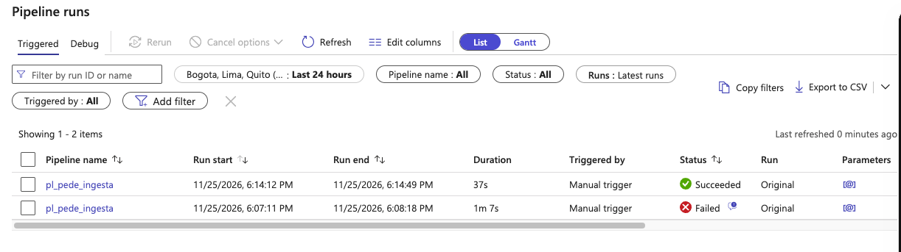
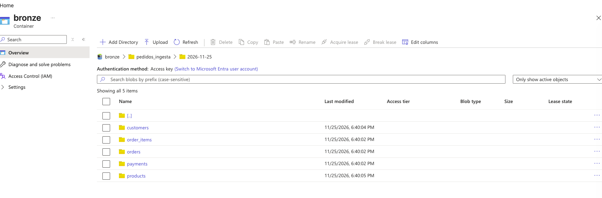
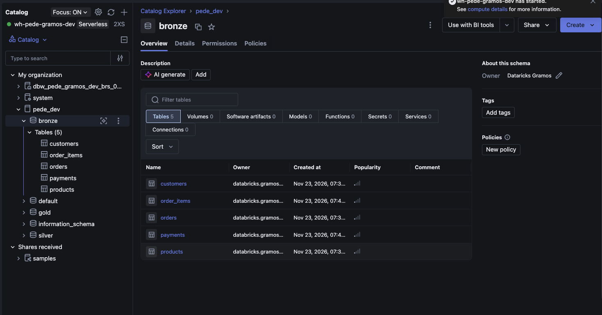
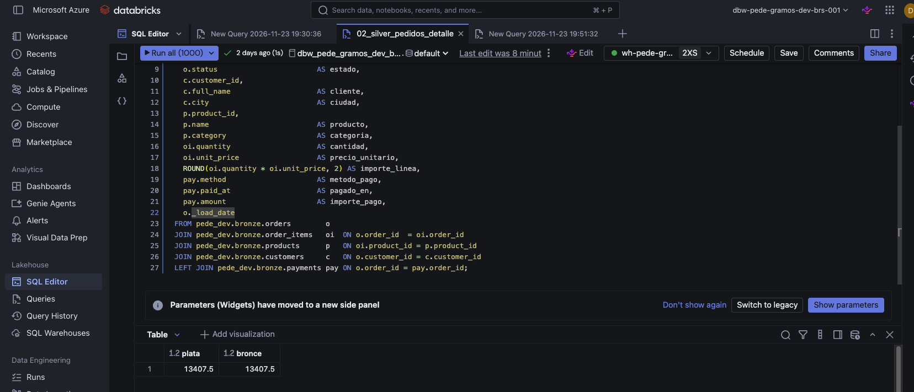
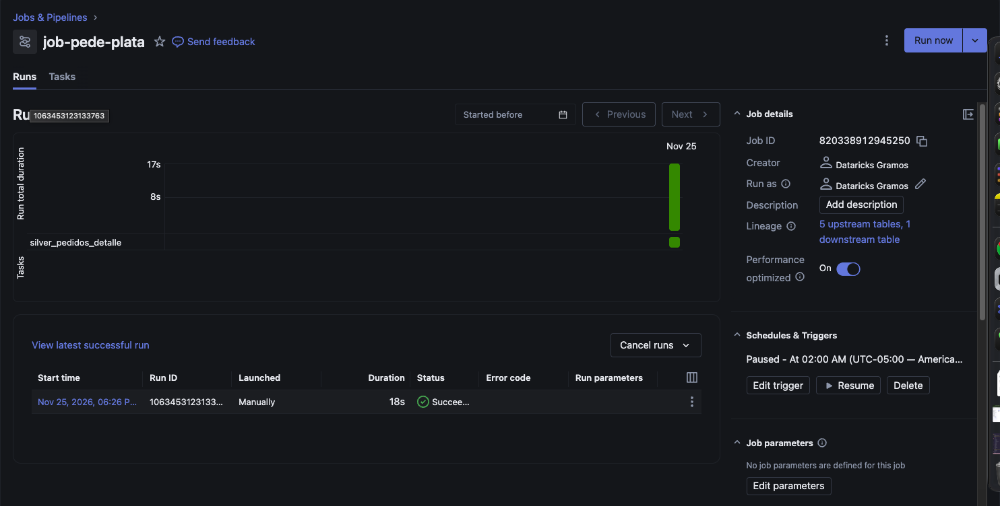
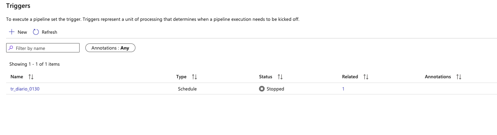

# Evidencia · Proyecto final · Andina Retail

**Alumna:** Gabriela Ramos · **Alias:** `gramos` · **Región:** Brazil South
Presentación: [`PF-gramos.pdf`](PF-gramos.pdf) (5 slides)

## Arquitectura (nombres reales)
`sql-pede-gramos-dev-brs-001` → `adf-pede-gramos-dev-brs-001` → `stpedegramosdldevbrs001` → `dbw-pede-gramos-dev-brs-001` → `wh-pede-gramos-dev`

Seguridad: contraseña del SQL en `kv-pede-gramos-dev-001`; acceso al lago por identidad administrada.

## Ingesta · Azure Data Factory
Pipeline `pl_pede_ingesta` (Lookup + ForEach + Copy parametrizado) en **Succeeded**. El run *Failed* previo se debió a la base Serverless en autopausa; se resolvió despertando la base y agregando reintentos al Copy.

Resultado en el lago, `bronze/pedidos_ingesta/2026-11-25/` con 5 carpetas:

## Bronce · tablas Delta

| Tabla | Filas |
|---|---|
| customers | 5 |
| products | 8 |
| orders | 10 |
| order_items | 15 |
| payments | 9 |

## Plata y calidad
`pede_dev.silver.pedidos_detalle`, grano de una fila por línea de pedido: **15 filas · 10 pedidos · 13.407,50**.

| Control | Resultado |
|---|---|
| Claves nulas | 0 |
| Duplicados por grano | 0 |
| Plata vs. bronce | 13407.50 = 13407.50 |

## Gold
`pede_dev.gold.ventas_por_canal` suma 13.407,50. Detalle en [`../etapa-06/evidencia-gold.md`](../etapa-06/evidencia-gold.md).

## Operación
- Job `job-pede-plata`: run **Succeeded**, schedule diario **Paused**.
- Trigger `tr_diario_0130` de ADF: **Stopped**.

## Limitaciones
- El bronce Delta se cargó desde `bronze/pedidos/fecha_carga=2026-10-10/` (carga manual de CSV). La ingesta automática de ADF escribe en `pedidos_ingesta/`; falta apuntar el bronce a esa ruta.
- Fuentes cubiertas: las 5 tablas core. No integré maestro de tiendas ni tipo de cambio.
- No hice la prueba de permisos RBAC/ACL con una segunda identidad (403 en `bronze`).
