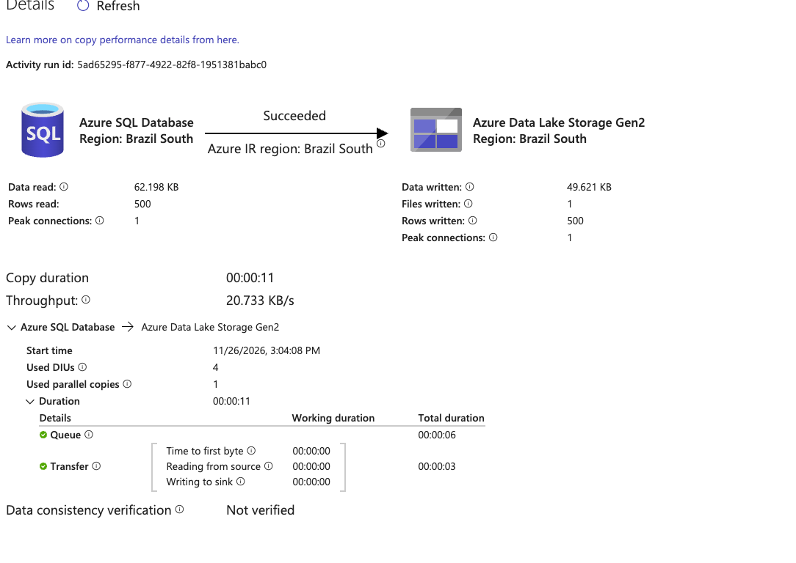
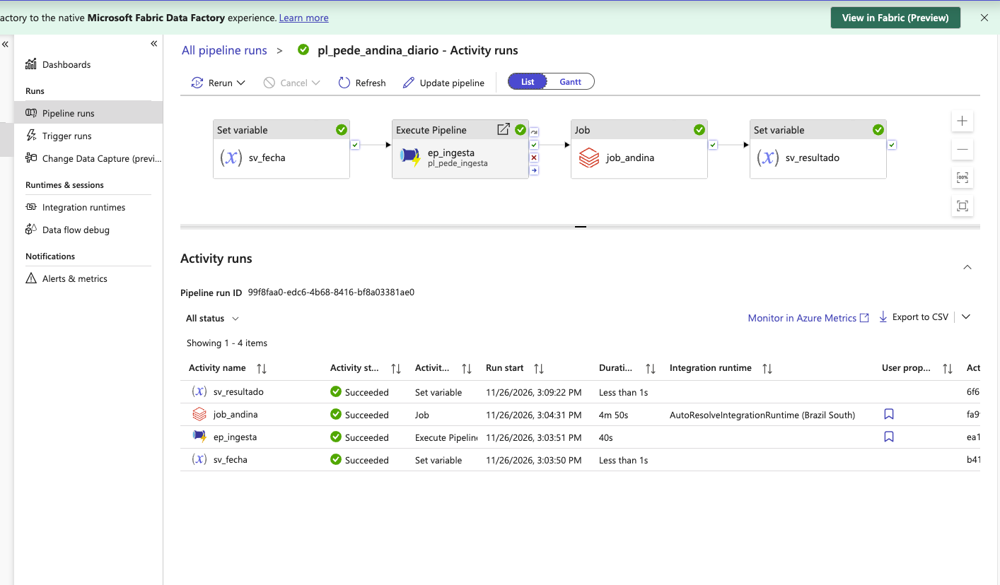
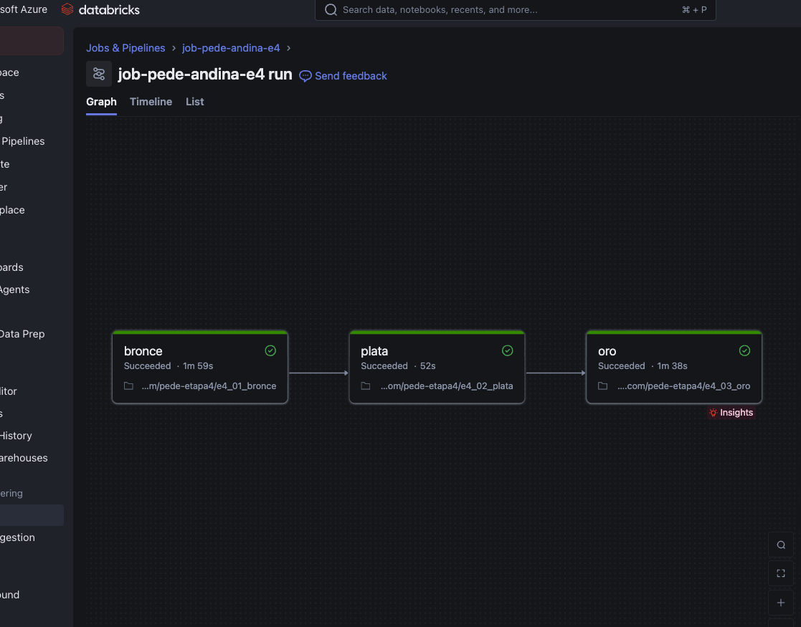
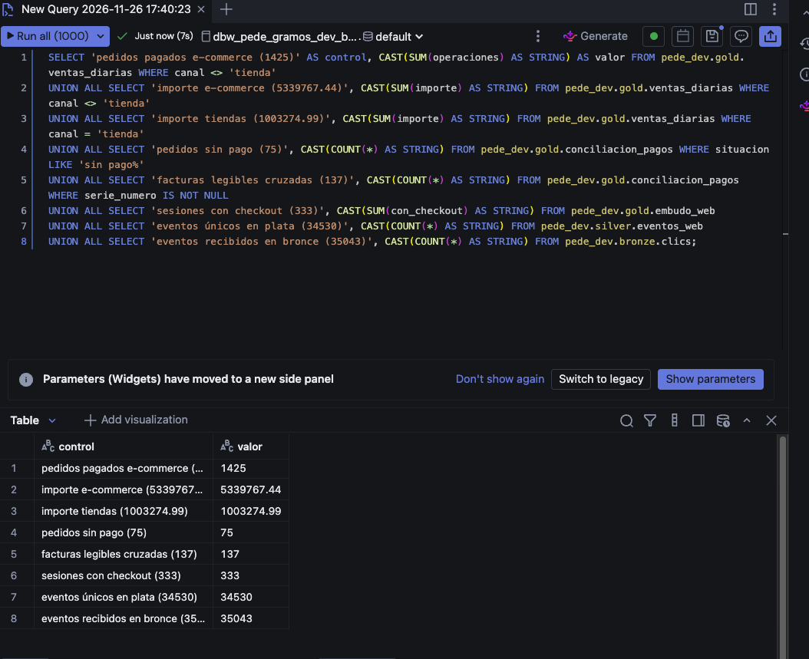
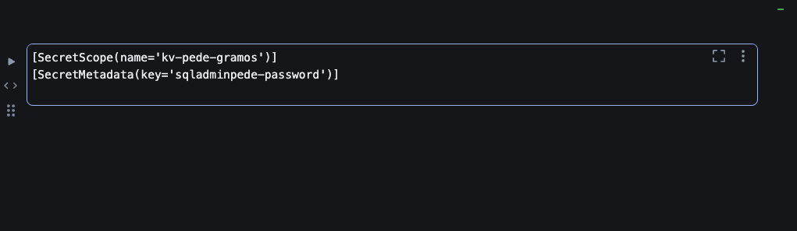
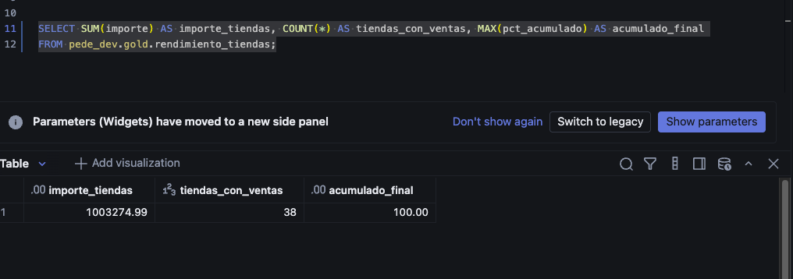
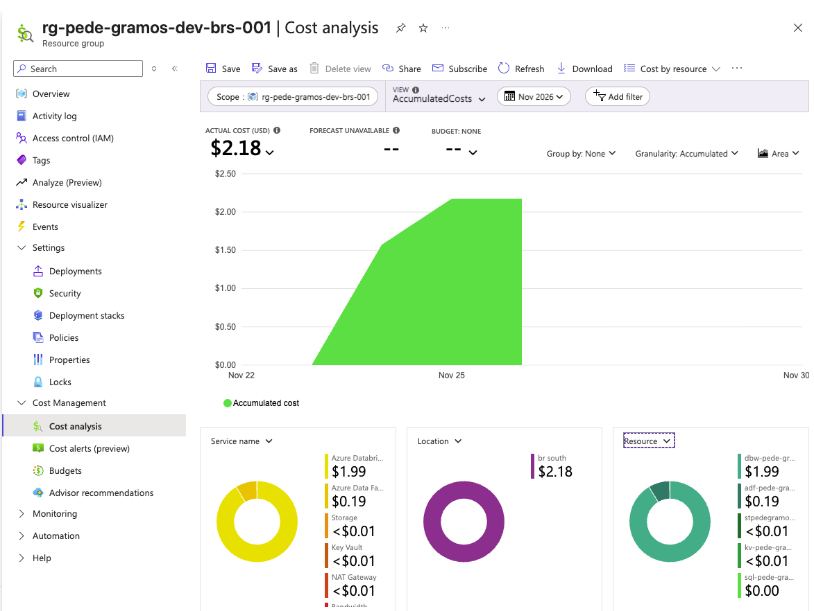

# Evidencia · Proyecto final Andina Retail (plataforma 1:1.000)

**Alumna:** Gabriela Ramos (`gramos`) · **Corrida:** 2026-11-26 · **Región:** Brazil South · **Catálogo:** `pede_dev`

Esta es la evidencia de la plataforma a escala 1:1.000. Las etapas 2 a 8 que entregué antes (muestra de 47 filas) quedan en sus carpetas como historial; el diseño y las decisiones vigentes están en [`DECISIONES.md`](DECISIONES.md).

## 1 · Resumen de la corrida

| Pieza | Identificador | Resultado | Duración |
|---|---|---|---|
| Pipeline maestro `pl_pede_andina_diario` (ADF) | run `99f8faa0-edc6-4b68-8416-bf8a03381ae0` | **Succeeded** | 340 s |
| ↳ Ingesta hija `pl_pede_ingesta` | run `79ad7639…` | Succeeded | |
| ↳ Job de Databricks `job-pede-andina-e4` (bronce → plata → oro) | run `118487434928214` | **SUCCESS** | 273 s |
| Job horario `job-pede-andina-e4-horario` (clics y logs) | 2 corridas manuales | Succeeded | |

## 2 · Ingesta con ADF (fuente 1)

- **Pipeline `pl_pede_ingesta`:** `lk_tablas` (Lookup) → `fe_tablas` (ForEach) → `cp_tabla` (Copy) + `av_tabla` (Append variable). Un solo par de datasets parametrizados (`ds_pede_sql_tabla`, `ds_pede_bronze_csv`) sirve a las 5 tablas.
- **Linked service del SQL parametrizado:** `ls_pede_sql_gramos` con parámetros `servidor` y `base`; la contraseña es una referencia al Key Vault (`AzureKeyVaultSecret`), nunca un valor.
- **Annotations:** `pf-andina`, `etapa4`, `ingesta` (y las de cada linked service, dataset y trigger).
- **User properties de cada `cp_tabla`:** `tabla`, `fecha` y `destino`, que aparecen como columnas en el Monitor:

| tabla | fecha | destino |
|---|---|---|
| customers | 2026-11-26 | `bronze/pedidos_ingesta/2026-11-26/customers` |
| products | 2026-11-26 | `bronze/pedidos_ingesta/2026-11-26/products` |
| orders | 2026-11-26 | `bronze/pedidos_ingesta/2026-11-26/orders` |
| order_items | 2026-11-26 | `bronze/pedidos_ingesta/2026-11-26/order_items` |
| payments | 2026-11-26 | `bronze/pedidos_ingesta/2026-11-26/payments` |

- **Resultado en el lago:** `bronze/pedidos_ingesta/2026-11-26/<tabla>/<tabla>.csv`, 5 carpetas.



*Detalle de `cp_tabla` para `customers` en el Monitor de ADF: 500 filas leídas de Azure SQL y 500 escritas en ADLS Gen2.*

- **Base de origen (1:1.000):** customers 500 · products 200 · orders 1.500 · order_items 3.489 · payments 1.425.
- **Otras 7 fuentes:** 381 archivos en `bronze/landing/` (ERP, clics, facturas, contratos, logs, puntajes, tipo de cambio y tiendas) más 4 de llegada tardía.

## 3 · Orquestación

- **Maestro `pl_pede_andina_diario`:** `sv_fecha` (Set variable) → `ep_ingesta` (Execute pipeline) → `job_andina` (Databricks Job) → `sv_resultado` (Set variable). Variables `v_fecha` y `v_resultado`.
- **Trigger `tg_pede_andina_0130`** (01:30 Lima): **Stopped**. Motivo en [`DECISIONES.md`](DECISIONES.md), punto 6.
- **Horario del job `job-pede-andina-e4-horario`** (minuto 5 de cada hora): **PAUSED**. Motivo en el punto 7.
- **Carga incremental (Auto Loader), probada a mano:**

| Corrida | Clics | Logs |
|---|---|---|
| Primera | 34.967 filas en 167 archivos | 125.316 filas en 18 archivos |
| Segunda (tras subir 4 archivos nuevos) | 35.043 en 168 (+76, 1 archivo) | 146.282 en 21 (+20.966, 3 archivos) |



*Monitor de ADF: `pl_pede_andina_diario` (run `99f8faa0…`) en Succeeded. `sv_fecha` → `ep_ingesta` → `job_andina` → `sv_resultado`, con la columna de user properties. El job de Databricks tardó 4 min 50 s.*

## 4 · Bronce, plata y oro en Unity Catalog

Inventario de `pede_dev.gold.auditoria_cargas`:

| zona | tablas | filas |
|---|---|---|
| bronze | 15 | 192.600 |
| silver | 12 (11 del curso + `pedidos_detalle` de S06) | 188.626 |
| gold | 9 auditadas (7 del curso + `ventas_por_canal` de S06 + `rendimiento_tiendas`) + `auditoria_cargas` | 3.073 |

Los tres notebooks están en [`notebooks/`](notebooks/) y se encadenan en el job `job-pede-andina-e4` (definiciones en [`databricks/`](databricks/)).



*Run del job `job-pede-andina-e4` (Databricks): `bronce` (1 min 59 s) → `plata` (52 s) → `oro` (1 min 38 s), las tres tareas en Succeeded.*

## 5 · Números de control

Consulta única sobre el oro y la plata (la del paso 7 de la guía). Los notebooks también los verifican con `assert`: si uno no cuadra, el job falla.

| Control | Esperado | Obtenido |
|---|---|---|
| Pedidos pagados del e-commerce | 1.425 | **1.425** |
| Importe e-commerce pagado | 5.339.767,44 | **5.339.767,44** |
| Importe de tiendas físicas (semana) | 1.003.274,99 | **1.003.274,99** |
| Pedidos sin pago (69 cancelados + 6 pendientes) | 75 | **75** |
| Facturas legibles cruzadas | 137 | **137** |
| Sesiones con checkout | 333 | **333** |
| Eventos únicos (plata) frente a recibidos (bronce) | 34.530 de 35.043 | **34.530 de 35.043** |



*La consulta y sus 8 resultados en el SQL Editor (warehouse `wh-pede-gramos-dev`).*

## 6 · Seguridad y secretos

- La contraseña del SQL vive **solo** en el Key Vault `kv-pede-gramos-dev-001` (secreto `sqladminpede-password`).
- ADF la lee por referencia desde `ls_pede_kv_gramos` con su identidad administrada (access policy con permiso *Get*).
- Databricks la ve por el secret scope `kv-pede-gramos`, respaldado por ese Key Vault. Salida de la CLI (solo nombres, ningún valor):

```
$ databricks secrets list-scopes
Scope           Backend Type
kv-pede-gramos  AZURE_KEYVAULT

$ databricks secrets list-secrets kv-pede-gramos
Key
sqladminpede-password
```

Y desde un notebook de Databricks con `dbutils.secrets.listScopes()` y `dbutils.secrets.list("kv-pede-gramos")`: aparecen el scope y el **nombre** del secreto, nunca su valor.



- Identidades administradas con roles mínimos: lago (`Storage Blob Data Contributor` para ADF y para el access connector), Key Vault (*Get* sobre secretos), workspace de Databricks (Contributor para ADF) y, dentro del workspace, ADF solo con `workspace-access` y `CAN_MANAGE_RUN` sobre el job diario.
- Ningún secreto, suscripción ni tenant en el repo: los JSON de `adf/` y `databricks/` se revisaron y el ID de suscripción se reemplazó por `<SUBSCRIPTION_ID>`.

## 7 · Extensión propia: `pede_dev.gold.rendimiento_tiendas`

- **Pregunta:** ¿qué tiendas físicas concentran la facturación?
- **Código:** sección 8b de [`notebooks/e4_03_oro.py`](notebooks/e4_03_oro.py).
- **Control de amarre:** `SUM(importe)` = **1.003.274,99**, igual que el importe de tiendas de `ventas_diarias`; el acumulado de la última tienda cierra en **100,00 %**. Ambos son `assert` del notebook y el run quedó en Succeeded.
- **Prueba (consulta sobre la tabla):**

```sql
SELECT ranking, tienda, ciudad, importe, pct_facturacion, pct_acumulado
FROM pede_dev.gold.rendimiento_tiendas ORDER BY ranking LIMIT 10;
SELECT SUM(importe) AS importe_tiendas, COUNT(*) AS tiendas_con_ventas, MAX(pct_acumulado) AS acumulado_final
FROM pede_dev.gold.rendimiento_tiendas;
```

| ranking | tienda | ciudad | importe | % | % acumulado |
|---|---|---|---|---|---|
| 1 | Andina Jesús María | Lima | 39.578,24 | 3,94 | 3,94 |
| 2 | Andina Comas | Lima | 35.458,72 | 3,53 | 7,48 |
| 3 | Andina La Molina | Lima | 35.369,08 | 3,53 | 11,00 |
| 4 | Andina San Isidro | Lima | 34.915,93 | 3,48 | 14,48 |
| 5 | Andina Surco | Lima | 33.827,95 | 3,37 | 17,86 |
| 6 | Andina Trujillo 4 | Trujillo | 32.328,58 | 3,22 | 21,08 |
| 7 | Andina Arequipa 4 | Arequipa | 31.936,52 | 3,18 | 24,26 |
| 8 | Andina Chiclayo 2 | Chiclayo | 31.789,86 | 3,17 | 27,43 |
| 9 | Andina Chiclayo 3 | Chiclayo | 31.561,95 | 3,15 | 30,58 |
| 10 | Andina Huancayo 2 | Huancayo | 30.242,70 | 3,01 | 33,59 |

Total: **1.003.274,99** en **38** tiendas con ventas, acumulado final **100,00**.



*La consulta de amarre sobre `pede_dev.gold.rendimiento_tiendas`: 1003274.99 · 38 · 100.00.*

## 8 · Costo del grupo de recursos

Captura de *Cost analysis* del grupo `rg-pede-gramos-dev-brs-001` (noviembre de 2026): **2,18 USD acumulados** desde que empecé a montar el entorno, de los cuales Azure Databricks 1,99 USD y Data Factory 0,19 USD; el resto (almacenamiento, Key Vault, SQL, red) es menor a 0,01 USD. Azure tarda hasta un día en reflejar el gasto, así que la cifra puede subir un poco con las corridas de hoy.



Con el trigger detenido, el horario del job en pausa, el warehouse detenido y el SQL serverless en autopausa, el gasto en reposo es casi cero. El workspace es de modo *Serverless*: no tiene grupo administrado ni NAT Gateway encendido.

## 9 · Incidencias de la corrida (y su solución)

| Intento | Resultado | Causa | Solución |
|---|---|---|---|
| Maestro, runs 1 y 2 | Failed en `job_andina` (error 3200, 0 corridas del job) | Databricks no reconocía a la identidad administrada de ADF; el rol Contributor sobre el workspace no bastó | Registrarla como service principal en el workspace con `CAN_MANAGE_RUN` solo sobre el job diario |
| Maestro, run 3 | Failed en `job_andina` (`workspace-access`) | La identidad registrada no tenía el *entitlement* para usar la API | Agregar solo `workspace-access` |
| Maestro, run 4 | **Succeeded** | | |
